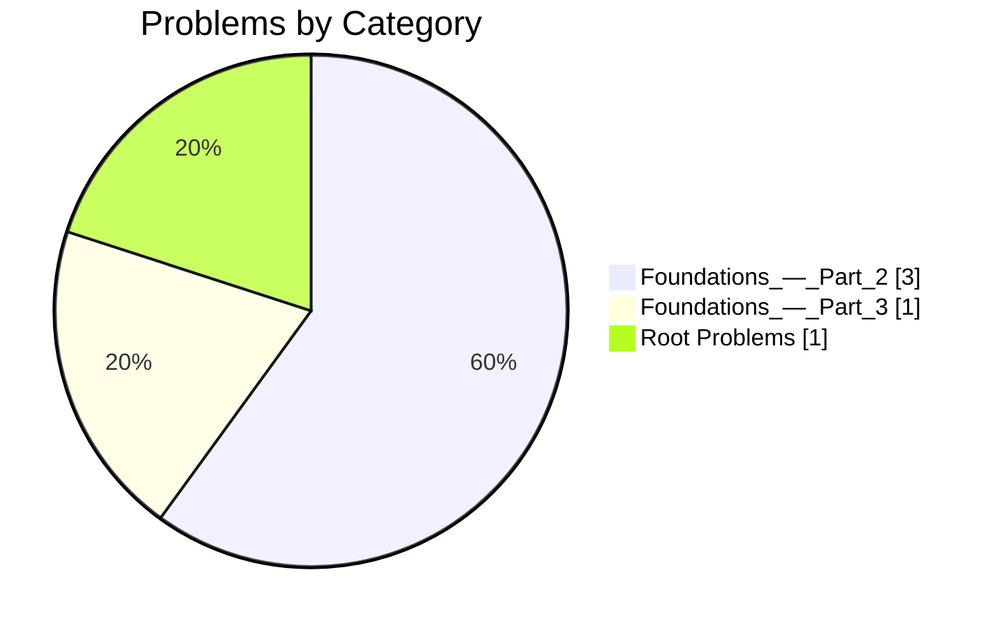

# 📚 DSA Progress Dashboard

A visual and automatically maintained dashboard for tracking DSA practice progress in this repository.

## ✍️ Manual Notes (maintained by hand)

- This repository stores solved problems in `/solutions`, design/problem writeups at the repository root, and learning notes in `/notes`.
- The dashboard below is generated from actual files and history.
- Please do not manually edit content inside the auto-generated block markers.

## ⚙️ How automation works

1. Add a new problem file under `/solutions/<category>/` (or a root problem/design file when needed).
2. Include useful metadata where possible (for example `PROBLEM:`, `DATE:`, `TOPIC:`, and problem/source links).
3. Commit your changes.
4. The workflow runs `scripts/update_readme.py` and updates this README automatically if dashboard content changed.

<!-- AUTO-GENERATED:START -->
> ⚙️ This section is auto-generated by `scripts/update_readme.py`.
> Changes inside this block are overwritten by automation.

## 📊 Dashboard


| Metric | Value |
|---|---:|
| Total problem files | 5 |
| Solution categories | 3 |
| Notes files | 1 |
| Tracked activity days | 4 |
| Current tracked streak (days) | 1 |
| Latest tracked update | 2026-10-19 |
| Problems with identified platform | 4/5 ████████████████░░░░ |

## 🧮 Progress Visual



## 🗂️ Problems by Category

| Category/Folder | Problems |
|---|---:|
| `Foundations_—_Part_2` | 3 |
| `Foundations_—_Part_3` | 1 |
| `Root Problems` | 1 |

## 🧠 Topics Inferred

| Topic | Problems |
|---|---:|
| Foundations — Part 2 | 3 |
| Foundations — Part 3 | 1 |
| General | 1 |

## 🌐 Platforms / Sources

| Platform/Source | Problems |
|---|---:|
| GeeksforGeeks | 4 |
| Unspecified | 1 |

## 💻 Languages Inferred

| Inferred language (from file extension) | Files |
|---|---:|
| Text | 5 |

## ✅ Problem Index

### Foundations_—_Part_2
| Problem | Topic | Platform | Date |
|---|---|---|---|
| [Print Numbers from 1 to N](solutions/Foundations_%E2%80%94_Part_2/2026-10-06_Print_Numbers_from_1_to_N.txt) | Foundations — Part 2 | GeeksforGeeks | 2026-10-06 |
| [Find Largest of Three Numbers](solutions/Foundations_%E2%80%94_Part_2/2026-10-06_Find_Largest_of_Three_Numbers.txt) | Foundations — Part 2 | GeeksforGeeks | 2026-10-06 |
| [Check Even or Odd](solutions/Foundations_%E2%80%94_Part_2/2026-10-06_Check_Even_or_Odd.txt) | Foundations — Part 2 | GeeksforGeeks | 2026-10-06 |

### Foundations_—_Part_3
| Problem | Topic | Platform | Date |
|---|---|---|---|
| [Pattern Printing](solutions/Foundations_%E2%80%94_Part_3/2026-10-07_Pattern_Printing.txt) | Foundations — Part 3 | GeeksforGeeks | 2026-10-07 |

### Root Problems
| Problem | Topic | Platform | Date |
|---|---|---|---|
| [Bus Seat Booking System](Leet%20Code%20Design%20Bus%20Seat%20Booking%20System) | General | Unspecified | Unknown |

## 📝 Notes

- [Day 19 Oct 2026](notes/Day_19_Oct_2026.md) — 2026-10-19

## 🕒 Recent Activity

| Date | Type | Item |
|---|---|---|
| 2026-10-19 | Note | [Day 19 Oct 2026](notes/Day_19_Oct_2026.md) |
| 2026-10-11 | Problem | [Bus Seat Booking System](Leet%20Code%20Design%20Bus%20Seat%20Booking%20System) |
| 2026-10-07 | Problem | [Pattern Printing](solutions/Foundations_%E2%80%94_Part_3/2026-10-07_Pattern_Printing.txt) |
| 2026-10-06 | Problem | [Check Even or Odd](solutions/Foundations_%E2%80%94_Part_2/2026-10-06_Check_Even_or_Odd.txt) |
| 2026-10-06 | Problem | [Find Largest of Three Numbers](solutions/Foundations_%E2%80%94_Part_2/2026-10-06_Find_Largest_of_Three_Numbers.txt) |
| 2026-10-06 | Problem | [Print Numbers from 1 to N](solutions/Foundations_%E2%80%94_Part_2/2026-10-06_Print_Numbers_from_1_to_N.txt) |

## 🧱 Repository Structure

```text
.
├── README.md
├── Leet Code Design Bus Seat Booking System
├── notes/
│   └── Day_19_Oct_2026.md
└── solutions/
    ├── Foundations_—_Part_2/
    │   ├── 2026-10-06_Check_Even_or_Odd.txt
    │   ├── 2026-10-06_Find_Largest_of_Three_Numbers.txt
    │   └── 2026-10-06_Print_Numbers_from_1_to_N.txt
    └── Foundations_—_Part_3/
        └── 2026-10-07_Pattern_Printing.txt
```
<!-- AUTO-GENERATED:END -->
